<div align="center">



<br>


</div>

```text
$ cat /etc/flicky.conf

focus     = real-time systems · applied AI · developer tooling
stack     = C++ · Python · TypeScript · MQTT · Docker
location  = Australia (UTC+10:30)
status    = building in stealth
```

### `// active`

**[realtime-telemetry-platform](https://github.com/flicky-official/realtime-telemetry-platform)**
Hardware → MQTT → live HUD. Runs with one command, no hardware needed.

### `// roadmap`

```text
[x] simulator → broker → browser HUD
[ ] C++ telemetry daemon
[ ] MQTT 5 · PostgreSQL · Flutter client
[ ] voice-driven dev loop for agentic coding
```

### `// signal`

[email](mailto:YOUR-EMAIL-HERE)
